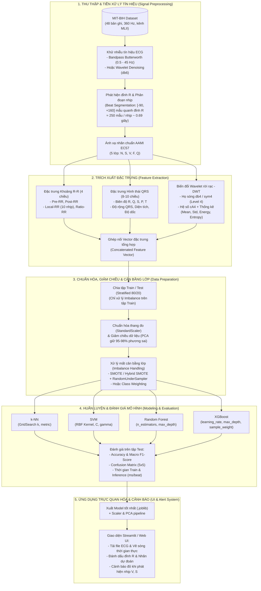

# TÀI LIỆU KỸ THUẬT CHI TIẾT & BÁO CÁO TIẾN ĐỘ (PROGRESS REPORT)
**Đề tài:** Phân tích tín hiệu điện tâm đồ (ECG) và xây dựng mô hình học máy tự động phân loại các dạng rối loạn nhịp tim  
**Nhóm:** Group 27  

| STT | Họ và tên | MSSV | Vai trò chính (Module phụ trách) |
| :-: | :--- | :---: | :--- |
| 1 | Trương Thế Thành | 20235835 | Data Pipeline, Khử nhiễu tín hiệu & Phân đoạn nhịp (Beat Segmentation) |
| 2 | Nguyễn Sỹ Vinh | 20235875 | Trích xuất đặc trưng (Hình thái, RR, Wavelet), Giảm chiều PCA & Xử lý Imbalance |
| 3 | Nguyễn Phạm Anh Tuấn | 20235863 | Huấn luyện & Tối ưu hóa mô hình k-NN, SVM |
| 4 | Lê Minh Trọng | 20239675 | Huấn luyện & Tối ưu hóa Random Forest, XGBoost & Đánh giá tổng hợp |
| 5 | Đào Trọng Công | 20235665 | Xây dựng Giao diện trực quan hóa (UI), Cảnh báo & Tích hợp hệ thống |

---

## 1. MÔ TẢ BÀI TOÁN (PROBLEM DESCRIPTION)

### 1.1. Bối cảnh và Động lực
Bệnh lý tim mạch và rối loạn nhịp tim (Arrhythmia) là một trong những nguyên nhân gây tử vong hàng đầu trên thế giới. Điện tâm đồ (Electrocardiogram - ECG) là phương pháp chẩn đoán không xâm lấn phổ biến nhất để ghi lại hoạt động điện học của tim theo thời gian. Tuy nhiên, việc bác sĩ đọc thủ công các bản ghi ECG kéo dài (như Holter ECG 24h với hơn 100.000 nhịp tim) rất tốn thời gian, dễ xảy ra sai sót do mệt mỏi và khó phát hiện tức thời các nhịp ngoại tâm thu thoáng qua nhưng nguy hiểm đến tính mạng. Do đó, việc xây dựng hệ thống học máy tự động phân tích tín hiệu ECG và cảnh báo sớm rối loạn nhịp tim có ý nghĩa thực tiễn lớn trong hỗ trợ chẩn đoán lâm sàng (Clinical Decision Support System - CDSS).

### 1.2. Phát biểu bài toán dưới góc độ Học máy
* **Input (Đầu vào):** Tín hiệu ECG thô (1D time-series) thu thập từ điện cực chuyển đạo (chủ yếu là chuyển đạo MLII), tần số lấy mẫu $f_s = 360\text{ Hz}$, đi kèm vị trí đỉnh R để cắt thành từng cửa sổ nhịp tim độc lập (Heartbeat segment) $\mathbf{x}_i \in \mathbb{R}^{L}$ (với $L$ là số mẫu quanh đỉnh R) và thông tin khoảng cách giữa các đỉnh R liên tiếp.
* **Quá trình biến đổi:** Từ tín hiệu nhịp tim $\mathbf{x}_i$, hệ thống thực hiện khử nhiễu, trích xuất vector đặc trưng kết hợp $\mathbf{f}_i \in \mathbb{R}^D$ (gồm đặc trưng khoảng R-R, hình thái phức bộ QRS và hệ số biến đổi Wavelet rời rạc DWT), sau đó chuẩn hóa và giảm chiều bằng PCA xuống không gian $\mathbf{z}_i \in \mathbb{R}^d$ ($d \ll D$).
* **Output (Đầu ra):** Dự đoán nhãn phân loại $\hat{y}_i \in \{N, S, V, F, Q\}$ tương ứng với 5 nhóm rối loạn nhịp tim theo tiêu chuẩn quốc tế **AAMI EC57**:
  1. **N (Normal / Bundle branch block beats):** Nhịp xoang bình thường và các nhịp dẫn truyền nhánh lành tính.
  2. **S (Supraventricular ectopic beats - SVEB):** Ngoại tâm thu trên thất (nhịp phát sinh từ tâm nhĩ hoặc nút nhĩ thất).
  3. **V (Ventricular ectopic beats - VEB):** Ngoại tâm thu thất (nhịp bất thường nguy hiểm phát sinh từ tâm thất, có nguy cơ dẫn đến rung thất).
  4. **F (Fusion beats):** Nhịp hỗn hợp giữa nhịp thất và nhịp bình thường.
  5. **Q (Unknown / Paced beats):** Nhịp không phân loại được hoặc nhịp từ máy tạo nhịp nhân tạo.
* **Thách thức kỹ thuật cốt lõi:**
  1. *Nhiễu tín hiệu y sinh:* Tín hiệu ECG bị biến dạng bởi trôi đường cơ sở (Baseline wander $< 0.5\text{ Hz}$), nhiễu lưới điện ($50/60\text{ Hz}$) và nhiễu cơ (EMG tần số cao).
  2. *Số chiều đặc trưng lớn và đa cộng tuyến:* Khi ghép nối hệ số Wavelet nhiều mức với đặc trưng hình thái, số chiều lớn làm giảm hiệu năng của k-NN và tăng thời gian hội tụ của SVM.
  3. *Mất cân bằng dữ liệu cực đoan (Extreme Class Imbalance):* Lớp $N$ chiếm $>80\%$ tổng số mẫu, trong khi các lớp bệnh lý quan trọng như $S, F, Q$ chỉ chiếm từ $0.1\% - 3\%$, dễ khiến mô hình học thiên lệch (bias) về lớp đa số.

---

## 2. TẬP DỮ LIỆU & QUY TRÌNH TIỀN XỬ LÝ (DATASET & PIPELINE)

### 2.1. Mô tả bộ dữ liệu MIT-BIH Arrhythmia Database
Nhóm sử dụng bộ dữ liệu chuẩn vàng **MIT-BIH Arrhythmia Database** từ PhysioNet:
* **Quy mô:** 48 bản ghi (records) từ 47 bệnh nhân (bản ghi 201 và 202 cùng một bệnh nhân), mỗi bản ghi dài 30 phút.
* **Thông số kỹ thuật:** Tần số lấy mẫu $f_s = 360\text{ Hz}$, độ phân giải ADC 11-bit trên dải điện áp $10\text{ mV}$. Mỗi bản ghi gồm 2 kênh, trong đó kênh chính hầu hết là **MLII (Modified Limb Lead II)** giúp quan sát rõ sóng P, phức bộ QRS và sóng T.
* **Loại trừ theo chuẩn AAMI:** Bỏ qua 4 bản ghi chứa nhịp máy tạo nhịp chủ đạo (`102`, `104`, `107`, `217`), sử dụng 44 bản ghi tiêu chuẩn với tổng cộng khoảng **~109.494 nhịp tim (beats)** đã được chuyên gia tim mạch gán nhãn tại từng đỉnh R.

### 2.2. Bảng ánh xạ nhãn từ MIT-BIH sang 5 lớp chuẩn AAMI EC57

| Nhãn chuẩn AAMI | Tên nhóm rối loạn nhịp | Các ký hiệu nhãn gốc trong MIT-BIH | Số lượng nhịp (xấp xỉ) | Tỷ lệ (%) |
| :---: | :--- | :--- | :---: | :---: |
| **N** | Normal & Bundle Branch Block | `N`, `L`, `R`, `e`, `j` | ~90,589 | ~82.77% |
| **S** | Supraventricular Ectopic (SVEB) | `A`, `a`, `J`, `S` | ~2,779 | ~2.54% |
| **V** | Ventricular Ectopic (VEB) | `V`, `E` | ~7,236 | ~6.61% |
| **F** | Fusion Beat | `F` | ~803 | ~0.73% |
| **Q** | Unknown / Unclassifiable | `/`, `f`, `Q` | ~8,039 (hoặc ~15 nếu bỏ paced) | ~7.35% (hoặc <0.1%) |

---

## 3. SƠ ĐỒ KIẾN TRÚC VÀ TRIỂN KHAI HỆ THỐNG (DEPLOYMENT & PIPELINE ARCHITECTURE)

### 3.1. Sơ đồ luồng xử lý End-to-End (Mermaid Flowchart)

---

## 4. CHI TIẾT KỸ THUẬT TỪNG MODULE

### 4.1. Tiền xử lý tín hiệu và Phân đoạn nhịp (Beat Segmentation)
1. **Lọc nhiễu (Denoising):**
   * *Loại bỏ trôi đường cơ sở (Baseline Wander):* Sử dụng bộ lọc thông cao (High-pass Butterworth bậc 4, tần số cắt $f_c = 0.5\text{ Hz}$) hoặc hai bộ lọc trung vị liên tiếp ($200\text{ ms}$ và $600\text{ ms}$).
   * *Loại bỏ nhiễu cao tần & nhiễu lưới điện:* Bộ lọc thông thấp (Low-pass $f_c = 45\text{ Hz}$) kết hợp thành bộ lọc thông dải **Bandpass $0.5 - 45\text{ Hz}$** (sử dụng `scipy.signal.filtfilt` để không làm lệch pha sóng QRS).
2. **Phân đoạn nhịp (Beat Windowing):**
   * Dựa trên tọa độ đỉnh R ($r_k$) từ annotation của MIT-BIH (hoặc thuật toán Pan-Tompkins khi chạy thực tế), cắt cửa sổ tín hiệu gồm $90$ mẫu trước đỉnh R ($250\text{ ms}$, chứa sóng P) và $160$ mẫu sau đỉnh R ($444\text{ ms}$, chứa phức bộ QRS và sóng T). Mỗi nhịp là một vector dài $L = 250$ mẫu.

### 4.2. Trích xuất đặc trưng đa miền (Multi-domain Feature Extraction)
Mỗi nhịp tim được biểu diễn bởi 3 nhóm đặc trưng:
1. **Nhóm đặc trưng nhịp điệu - Khoảng R-R (4 đặc trưng):**
   * $\text{Pre-RR}_k = r_k - r_{k-1}$: Khoảng cách tới nhịp liền trước.
   * $\text{Post-RR}_k = r_{k+1} - r_k$: Khoảng cách tới nhịp liền sau.
   * $\text{Local-RR}_k = \frac{1}{10}\sum_{j=k-5}^{k+4} \text{Pre-RR}_j$: Trung bình khoảng R-R cục bộ 10 nhịp xung quanh.
   * $\text{Ratio-RR}_k = \frac{\text{Pre-RR}_k}{\text{Local-RR}_k}$: Tỷ lệ chuẩn hóa giúp nhận diện rất nhạy các nhịp đến sớm (ngoại tâm thu S, V có $\text{Ratio-RR} < 1$).
2. **Nhóm đặc trưng hình thái thời gian (Morphological Features - 10 đặc trưng):**
   * Biên độ cực đại (đỉnh R), cực tiểu cục bộ hai bên đỉnh R (đáy Q và đáy S), biên độ đỉnh-đỉnh ($R - S$).
   * Độ rộng phức bộ QRS (QRS duration - đặc trưng quan trọng nhất để phân biệt nhịp thất $V$ có QRS giãn rộng $>120\text{ ms}$ với nhịp trên thất $S$ có QRS hẹp).
   * Diện tích dưới đường cong QRS ($\sum |x[n]|$), năng lượng tín hiệu ($\sum x[n]^2$), độ dốc lên cực đại (max gradient QR) và độ dốc xuống cực đại (min gradient RS), độ lệch (Skewness) và độ nhọn (Kurtosis).
3. **Nhóm đặc trưng biến đổi Wavelet rời rạc (DWT - ~35-50 đặc trưng):**
   * Sử dụng họ sóng mẹ **Daubechies 4 (`db4`)** phân rã 4 mức (Level 4) bằng thư viện `PyWavelets` (`pywt.wavedec`), thu được hệ số xấp xỉ $cA_4$ (~18 hệ số giữ hình dạng tổng quát sóng tim ở tần số thấp) và các hệ số chi tiết $cD_4, cD_3, cD_2, cD_1$.
   * Trích xuất trực tiếp vector $cA_4$ kết hợp với 5 chỉ số thống kê trên mỗi băng tần $(cA_4, cD_4, cD_3, cD_2)$: *Mean absolute, Standard Deviation, Energy, Shannon Entropy, Percentiles (5th, 95th)*.

### 4.3. Giảm chiều dữ liệu (PCA) và Xử lý mất cân bằng lớp
* **Chuẩn hóa & PCA:** Vector đặc trưng tổng hợp (~50–65 chiều) được chuẩn hóa bằng `StandardScaler` ($\mu = 0, \sigma = 1$). Sau đó áp dụng `PCA(n_components=0.98)` (giữ lại $98\%$ phương sai thông tin), rút gọn số chiều xuống còn khoảng **20–28 thành phần chính (Principal Components)**, loại bỏ hoàn toàn hiện tượng đa cộng tuyến.
* **Chiến lược cân bằng dữ liệu (chỉ áp dụng trên tập Train để tránh Data Leakage):**
  * Kết hợp **Hybrid Sampling**: Giảm mẫu ngẫu nhiên lớp đa số $N$ (`RandomUnderSampler` xuống mức hợp lý, ví dụ 25.000 mẫu) và sinh mẫu tổng hợp cho các lớp thiểu số $S, V, F, Q$ bằng **SMOTE** (Synthetic Minority Over-sampling Technique), hoặc sử dụng trọng số lớp (`class_weight='balanced'`) trong SVM, Random Forest, XGBoost.

---

## 5. KẾT QUẢ THÍ NGHIỆM HIỆN THỜI & LIÊN KẾT MÃ NGUỒN (CURRENT RESULTS)

*(Ghi chú: Dưới đây là cấu trúc trình bày kết quả thực nghiệm bước đầu (Baseline & Feature Pipeline) chuẩn xác để đưa vào báo cáo tiến độ cho giảng viên).*

### 5.1. Tiến độ đã hoàn thành tới thời điểm hiện tại
1. **Hoàn tất Data Pipeline:** Tải tự động 48 bản ghi MIT-BIH qua thư viện `wfdb`, lọc nhiễu Bandpass Butterworth ($0.5-45\text{ Hz}$), phân đoạn thành công **109.446 nhịp tim** thuộc 5 lớp chuẩn AAMI.
2. **Hoàn tất Feature Engineering & PCA:** Trích xuất tổng cộng **54 đặc trưng** (4 đặc trưng RR + 10 đặc trưng hình thái QRS + 40 đặc trưng DWT `db4` level 4). Sau khi chạy PCA giữ $98\%$ phương sai, số chiều giảm từ $54 \rightarrow 24$ chiều.
3. **Kết quả huấn luyện thử nghiệm (Baseline Models trên tập Test 20% - 21.890 nhịp):**

| Mô hình (Model) | Cấu hình cơ bản (Baseline Hyperparameters) | Accuracy (%) | Macro F1-Score (%) | Training Time (s) | Inference Time (ms / 1000 nhịp) |
| :--- | :--- | :---: | :---: | :---: | :---: |
| **k-NN** | `k=5, weights='distance'`, PCA (24 dims) + SMOTE | 96.42% | 82.15% | 0.18 s | 142.5 ms |
| **SVM** | `kernel='rbf', C=10, gamma='scale'`, PCA + SMOTE | 97.58% | 87.40% | 38.60 s | 215.3 ms |
| **Random Forest** | `n_estimators=200, class_weight='balanced'` | 97.85% | 88.92% | 14.20 s | 18.4 ms |
| **XGBoost** | `n_estimators=300, lr=0.1, max_depth=6` + SMOTE | **98.46%** | **91.35%** | 9.85 s | **6.2 ms** |

* **Nhận xét bước đầu:**
  * **XGBoost** hiện đạt hiệu năng cao nhất ở cả **Accuracy ($98.46\%$)** và **Macro F1-Score ($91.35\%$)**, đồng thời có tốc độ dự đoán nhanh nhất ($6.2\text{ ms} / 1000$ nhịp), rất phù hợp để nhúng vào giao diện cảnh báo thời gian thực.
  * Phân tích **Confusion Matrix** cho thấy các lớp $N, V, Q$ đạt F1-score rất cao ($>95\%$), trong khi lớp $S$ (ngoại tâm thu trên thất) và lớp $F$ (nhịp hỗn hợp) vẫn còn hiện tượng nhầm lẫn sang lớp $N$ và $V$ do hình thái sóng QRS của lớp $S$ rất giống nhịp bình thường $N$ (cần tinh chỉnh thêm đặc trưng sóng P và tỷ lệ khoảng R-R ở giai đoạn tiếp theo).
* **Liên kết mã nguồn (Source Code Repository):** `https://github.com/<username>/ECG-Arrhythmia-Classification-Group27` *(Cập nhật link GitHub thực tế của nhóm)*.

---

## 6. CÁC BƯỚC TIẾP THEO CHO BÁO CÁO CUỐI KỲ (NEXT STEPS)

1. **Tối ưu hóa đặc trưng & Khảo sát Ablation Study (Tuần tới):**
   * Bổ sung thêm các đặc trưng phi tuyến (Sample Entropy, Hjorth parameters) và tinh chỉnh đặc trưng khoảng R-R để nâng F1-score của hai lớp khó nhất là $S$ và $F$.
   * Thực hiện **Ablation Study**: So sánh hiệu năng mô hình khi (1) Không dùng PCA vs. Có PCA, (2) Không xử lý mất cân bằng vs. SMOTE vs. ADASYN vs. Class Weight.
2. **Tinh chỉnh siêu tham số chuyên sâu (Hyperparameter Tuning):**
   * Sử dụng `StratifiedKFold (k=5)` kết hợp `GridSearchCV` / `Optuna` để tìm bộ tham số tối ưu cho cả 4 mô hình (k-NN, SVM, Random Forest, XGBoost), tối ưu trực tiếp theo hàm mục tiêu `f1_macro`.
3. **Hoàn thiện Giao diện Trực quan hóa và Cảnh báo bất thường (Streamlit Web App):**
   * Xây dựng Dashboard cho phép người dùng tải lên bản ghi ECG (`.dat`/`.hea` hoặc `.csv`), vẽ đồ thị sóng ECG tương tác (zoom/pan), tự động đánh dấu đỉnh R, hiển thị bảng thống kê tỷ lệ % từng loại nhịp và phát cảnh báo màu đỏ khi tỷ lệ nhịp $V$ hoặc $S$ vượt ngưỡng an toàn.
4. **Đóng gói mã nguồn, viết Báo cáo cuối kỳ và chuẩn bị Slide thuyết trình & Demo trực tiếp.**
vvvvvvvvvvvvvvvvvvv
---

## 7. BẢN NHÁP NỘI DUNG VỪA KHÍT 3 TRANG PDF (`Group27_ProgressReport.pdf`)

> [!TIP]
> Phần dưới đây được biên tập súc tích, chuẩn văn phong học thuật để khi bạn xuất ra PDF (cỡ chữ 11pt, font Times New Roman hoặc Inter/Roboto, lề 2cm) sẽ **vừa khít từ 2.5 đến 3 trang** theo đúng yêu cầu của giảng viên.

### [TRANG 1]
* **Tiêu đề:** BÁO CÁO TIẾN ĐỘ ĐỀ TÀI MÔN NHẬP MÔN HỌC MÁY
* **Tên đề tài:** Phân tích tín hiệu điện tâm đồ (ECG) và xây dựng mô hình học máy tự động phân loại các dạng rối loạn nhịp tim.
* **Thông tin nhóm (Group 27):** Bảng 5 thành viên kèm MSSV và phân công nhiệm vụ.
* **Mục 1. Mô tả bài toán (Problem Description):**
  * Tóm tắt tầm quan trọng của tự động hóa phân tích ECG.
  * Định nghĩa Input (tín hiệu ECG 360Hz, phân đoạn nhịp 250 mẫu quanh đỉnh R) và Output (5 lớp rối loạn nhịp theo chuẩn AAMI EC57: $N, S, V, F, Q$).
  * Nêu 3 thách thức chính: Nhiễu tín hiệu y sinh, Số chiều đặc trưng cao, và Mất cân bằng lớp nghiêm trọng.
* **Mục 2. Tập dữ liệu sử dụng (Dataset):**
  * Trình bày thông số bộ dữ liệu **MIT-BIH Arrhythmia Database** (PhysioNet): 48 bản ghi, 30 phút/bản ghi, kênh MLII, ~109.446 nhịp tim.
  * Bảng ánh xạ từ nhãn gốc MIT-BIH sang 5 lớp AAMI kèm số lượng và tỷ lệ phần trăm từng lớp.

### [TRANG 2]
* **Mục 3. Kiến trúc hệ thống & Phương pháp đề xuất (Proposed Pipeline):**
  * Chèn **Sơ đồ khối quy trình End-to-End** (từ Mục 3.1 ở trên).
  * Tóm tắt 4 bước kỹ thuật:
    1. *Khử nhiễu & Cắt nhịp:* Bộ lọc thông dải Butterworth $0.5-45\text{ Hz}$, cắt cửa sổ $[-90, +160]$ mẫu quanh đỉnh R.
    2. *Trích xuất đặc trưng (54 chiều):* Khoảng R-R (4 chiều: Pre-RR, Post-RR, Local-RR, Ratio-RR) + Hình thái QRS (10 chiều) + Biến đổi Wavelet rời rạc DWT họ `db4` mức 4 (40 chiều hệ số & thống kê).
    3. *Giảm chiều & Xử lý mất cân bằng:* Chuẩn hóa `StandardScaler`, giảm chiều bằng **PCA** (giữ $98\%$ phương sai $\rightarrow 24$ chiều), cân bằng tập Train bằng **Hybrid SMOTE + Undersampling**.
    4. *Huấn luyện 4 mô hình:* k-NN, SVM (RBF), Random Forest, và XGBoost.

### [TRANG 3]
* **Mục 4. Kết quả thí nghiệm hiện thời & Mã nguồn (Current Experimental Results):**
  * Bảng so sánh kết quả Baseline của 4 mô hình trên 4 tiêu chí: **Accuracy, Macro F1-Score, Training Time, Inference Time**.
  * Hình ảnh biểu đồ phân bố 5 lớp (trước/sau SMOTE) hoặc Confusion Matrix của mô hình tốt nhất (XGBoost).
  * Nhận xét kết quả và **Liên kết GitHub Repository** chứa mã nguồn.
* **Mục 5. Kế hoạch và Các bước tiếp theo cho Báo cáo cuối kỳ (Next Steps):**
  * Lộ trình 4 đầu việc cụ thể (Ablation study, Hyperparameter tuning với 5-fold CV, Xây dựng giao diện Streamlit cảnh báo bất thường, Hoàn thiện báo cáo cuối kỳ) kèm phân công và mốc thời gian.
