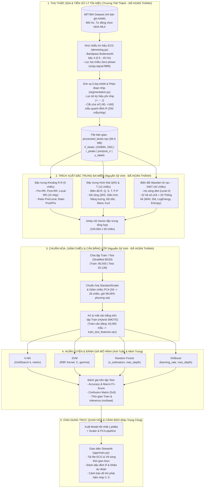

# TÀI LIỆU KỸ THUẬT CHI TIẾT & BÁO CÁO TIẾN ĐỘ (PROGRESS REPORT)
**Đề tài:** Phân tích tín hiệu điện tâm đồ (ECG) và xây dựng mô hình học máy tự động phân loại các dạng rối loạn nhịp tim  
**Nhóm:** Group 27  

| STT | Họ và tên | MSSV | Vai trò chính (Module phụ trách) | Trạng thái hiện tại |
| :-: | :--- | :---: | :--- | :---: |
| 1 | **Trương Thế Thành** | **20235835** | **Hạ tầng Repo, Data Pipeline, EDA, Khử nhiễu tín hiệu & Phân đoạn nhịp (Beat Segmentation)** | **Đã hoàn thành 100%** |
| 2 | **Nguyễn Sỹ Vinh** | **20235875** | **Trích xuất đặc trưng (Hình thái, RR, Wavelet), Giảm chiều PCA & Xử lý Imbalance (SMOTE)** | **Đã hoàn thành 100%** |
| 3 | Nguyễn Phạm Anh Tuấn | 20235863 | Huấn luyện & Tối ưu hóa mô hình k-NN, SVM | Đang thực hiện (Đã nhận `train_test_features.npz`) |
| 4 | Lê Minh Trọng | 20239675 | Huấn luyện & Tối ưu hóa Random Forest, XGBoost & Đánh giá tổng hợp | Đang thực hiện (Đã nhận `train_test_features.npz`) |
| 5 | Đào Trọng Công | 20235665 | Xây dựng Giao diện trực quan hóa (UI), Cảnh báo & Tích hợp hệ thống | Đã khởi tạo khung `app/main.py` & nhận `feature_pipeline.joblib` |

---

## 1. MÔ TẢ BÀI TOÁN (PROBLEM DESCRIPTION)

### 1.1. Bối cảnh và Động lực
Bệnh lý tim mạch và rối loạn nhịp tim (Arrhythmia) là một trong những nguyên nhân gây tử vong hàng đầu trên thế giới. Điện tâm đồ (Electrocardiogram - ECG) là phương pháp chẩn đoán không xâm lấn phổ biến nhất để ghi lại hoạt động điện học của tim theo thời gian. Tuy nhiên, việc bác sĩ đọc thủ công các bản ghi ECG kéo dài (như Holter ECG 24h với hơn 100.000 nhịp tim) rất tốn thời gian, dễ xảy ra sai sót do mệt mỏi và khó phát hiện tức thời các nhịp ngoại tâm thu thoáng qua nhưng nguy hiểm đến tính mạng. Do đó, việc xây dựng hệ thống học máy tự động phân tích tín hiệu ECG và cảnh báo sớm rối loạn nhịp tim có ý nghĩa thực tiễn lớn trong hỗ trợ chẩn đoán lâm sàng (Clinical Decision Support System - CDSS).

### 1.2. Phát biểu bài toán dưới góc độ Học máy
* **Input (Đầu vào):** Tín hiệu ECG thô (1D time-series) thu thập từ điện cực chuyển đạo **MLII**, tần số lấy mẫu $f_s = 360\text{ Hz}$, đi kèm vị trí đỉnh R ($r_k$) để cắt thành từng cửa sổ nhịp tim độc lập (Heartbeat segment) $\mathbf{x}_k \in \mathbb{R}^{250}$ (`[-90, +160]` mẫu quanh đỉnh R) và thông tin khoảng cách giữa các đỉnh R liên tiếp.
* **Quá trình biến đổi:** Từ tín hiệu nhịp tim $\mathbf{x}_k$, hệ thống thực hiện khử nhiễu Bandpass Butterworth ($0.5-45\text{ Hz}$), trích xuất vector đặc trưng kết hợp $\mathbf{f}_k \in \mathbb{R}^D$ (gồm đặc trưng khoảng R-R, hình thái phức bộ QRS và hệ số biến đổi Wavelet rời rạc DWT), sau đó chuẩn hóa và giảm chiều bằng PCA xuống không gian $\mathbf{z}_k \in \mathbb{R}^d$ ($d \ll D$).
* **Output (Đầu ra):** Dự đoán nhãn phân loại $\hat{y}_k \in \{N, S, V, F, Q\}$ (mã hóa thành $\{0, 1, 2, 3, 4\}$) tương ứng với 5 nhóm rối loạn nhịp tim theo tiêu chuẩn quốc tế **AAMI EC57**:
  1. **N (Normal / Bundle branch block beats - Nhãn 0):** Nhịp xoang bình thường và các nhịp dẫn truyền nhánh lành tính.
  2. **S (Supraventricular ectopic beats - SVEB - Nhãn 1):** Ngoại tâm thu trên thất (nhịp phát sinh từ tâm nhĩ hoặc nút nhĩ thất).
  3. **V (Ventricular ectopic beats - VEB - Nhãn 2):** Ngoại tâm thu thất (nhịp bất thường nguy hiểm phát sinh từ tâm thất, có nguy cơ dẫn đến rung thất).
  4. **F (Fusion beats - Nhãn 3):** Nhịp hỗn hợp giữa nhịp thất và nhịp bình thường.
  5. **Q (Unknown / Unclassifiable beats - Nhãn 4):** Nhịp không phân loại được hoặc nhịp lai máy tạo nhịp.
* **Thách thức kỹ thuật cốt lõi:**
  1. *Nhiễu tín hiệu y sinh:* Tín hiệu ECG bị biến dạng bởi trôi đường cơ sở (Baseline wander $< 0.5\text{ Hz}$), nhiễu lưới điện ($50/60\text{ Hz}$) và nhiễu cơ (EMG tần số cao).
  2. *Số chiều đặc trưng lớn và đa cộng tuyến:* Khi ghép nối hệ số Wavelet nhiều mức với đặc trưng hình thái, số chiều lớn làm giảm hiệu năng của k-NN và tăng thời gian hội tụ của SVM.
  3. *Mất cân bằng dữ liệu cực đoan (Extreme Class Imbalance):* Kết quả thống kê thực tế trên 44 bản ghi chuẩn AAMI cho thấy lớp $N$ chiếm tới **$89.47\%$**, trong khi các lớp bệnh lý như $S$ ($2.76\%$), $F$ ($0.80\%$), $Q$ ($0.01\%$) chiếm tỷ lệ rất nhỏ, dễ khiến mô hình học thiên lệch (bias) về lớp đa số.

---

## 2. TẬP DỮ LIỆU & KẾT QUẢ KHÁM PHÁ DỮ LIỆU THỰC TẾ (DATASET & EDA)

### 2.1. Mô tả bộ dữ liệu MIT-BIH Arrhythmia Database
Nhóm sử dụng bộ dữ liệu chuẩn vàng **MIT-BIH Arrhythmia Database** từ PhysioNet:
* **Quy mô gốc:** 48 bản ghi (records) từ 47 bệnh nhân (mỗi bản ghi dài 30 phút, tần số lấy mẫu $f_s = 360\text{ Hz}$, độ phân giải 11-bit trên dải điện áp $10\text{ mV}$).
* **Lọc bản ghi theo chuẩn AAMI EC57:** Đã loại bỏ 4 bản ghi chứa nhịp máy tạo nhịp chủ đạo (`102`, `104`, `107`, `217`), giữ lại **44 bản ghi tiêu chuẩn** trong thư mục `data/raw/`.
* **Tự động chuẩn hóa kênh chuyển đạo `MLII`:** Qua quá trình EDA kiểm tra header (`.hea`) của cả 44 bản ghi, nhóm phát hiện có 43/44 bản ghi đặt kênh `MLII` ở kênh 0, riêng **bản ghi `114`** đặt kênh `V5` ở kênh 0 và **`MLII` ở kênh 1**. Module tiền xử lý (`select_mlii_channel`) đã tự động kiểm tra `record.sig_name` và chuyển sang kênh 1 đối với bản ghi `114` để đảm bảo tính đồng nhất hình thái sóng tim trên toàn bộ tập dữ liệu.

### 2.2. Bảng thống kê thực tế 5 lớp chuẩn AAMI EC57 (44 bản ghi MIT-BIH)
*(Số liệu thực tế trích xuất từ file [aami_class_distribution.csv](file:///d:/20261/Nhập%20môn%20học%20máy/ECG-Arrhythmia-Classification/results/aami_class_distribution.csv) và [processed_beats.npz](file:///d:/20261/Nhập%20môn%20học%20máy/ECG-Arrhythmia-Classification/data/processed/processed_beats.npz))*

| Mã số (`y_labels`) | Nhãn chuẩn AAMI | Tên nhóm rối loạn nhịp | Ký hiệu gốc trong MIT-BIH (`.atr`) | Tổng số đỉnh R trong `.atr` | Số nhịp hợp lệ sau cắt cửa sổ `[-90, +160]` | Tỷ lệ (%) |
| :---: | :---: | :--- | :--- | :---: | :---: | :---: |
| **0** | **N** | Normal & Bundle Branch Block | `N`, `L`, `R`, `e`, `j` | 90,125 | **90,088** | **89.47%** |
| **1** | **S** | Supraventricular Ectopic (SVEB) | `A`, `a`, `J`, `S` | 2,781 | **2,781** | **2.76%** |
| **2** | **V** | Ventricular Ectopic (VEB) | `V`, `E` | 7,009 | **7,008** | **6.96%** |
| **3** | **F** | Fusion Beat | `F` | 803 | **802** | **0.80%** |
| **4** | **Q** | Unknown / Unclassifiable | `/`, `f`, `Q` | 15 | **15** | **0.01%** |
| — | **Tổng** | **5 nhóm chuẩn AAMI** | *Đã loại bỏ ký hiệu phi nhịp (`+`, `~`, `\|`...)* | **100,733** | **100,694** | **100.00%** |

*(Ghi chú: 39 nhịp nằm sát biên giây đầu tiên $r_k < 90$ hoặc giây cuối cùng $r_k + 160 > 650,000$ của bản ghi 30 phút đã được loại bỏ để đảm bảo 100% nhịp cắt ra đều có đúng kích thước 250 mẫu).*

---

## 3. SƠ ĐỒ KIẾN TRÚC VÀ TRIỂN KHAI HỆ THỐNG (DEPLOYMENT & PIPELINE ARCHITECTURE)

---

## 4. CHI TIẾT KỸ THUẬT CÁC MODULE & PHẦN VIỆC ĐÃ HOÀN THÀNH CỦA NGƯỜI 1 (TRƯƠNG THẾ THÀNH)

### 4.1. Chi tiết triển khai Bước 1, Bước 2 và Bước 3 (Trương Thế Thành - 20235835)

#### A. Bước 1: Khởi tạo hạ tầng Repository & Cấu hình dùng chung
* Thiết lập cấu trúc thư mục chuẩn cho 5 thành viên làm việc song song: `data/`, `src/preprocessing/`, `src/features/`, `src/models/`, `app/`, `results/`, `saved_models/`.
* Xây dựng file [src/config.py](file:///d:/20261/Nhập%20môn%20học%20máy/ECG-Arrhythmia-Classification/src/config.py) định nghĩa toàn bộ hằng số hệ thống: `SAMPLING_RATE = 360`, `WINDOW_BEFORE_R = 90`, `WINDOW_AFTER_R = 160`, `BEAT_LENGTH = 250`, danh sách 48 bản ghi `MIT_BIH_RECORDS`, 4 bản ghi loại trừ `AAMI_EXCLUDED_RECORDS = ['102', '104', '107', '217']`, từ điển `AAMI_MAPPING` và `LABEL_TO_ID`.
* Xây dựng [requirements.txt](file:///d:/20261/Nhập%20môn%20học%20máy/ECG-Arrhythmia-Classification/requirements.txt), [.gitignore](file:///d:/20261/Nhập%20môn%20học%20máy/ECG-Arrhythmia-Classification/.gitignore) và [README.md](file:///d:/20261/Nhập%20môn%20học%20máy/ECG-Arrhythmia-Classification/README.md) quy định rõ **Data Contract** giữa các thành viên.

#### B. Bước 2: Tải dữ liệu tự động & Khám phá dữ liệu (EDA)
* **Script tải dữ liệu ([data/download_mitbih.py](file:///d:/20261/Nhập%20môn%20học%20máy/ECG-Arrhythmia-Classification/data/download_mitbih.py)):** Sử dụng `wfdb.dl_database('mitdb', dl_dir='data/raw')` kết hợp cơ chế kiểm tra file tồn tại (`.dat`, `.hea`, `.atr`) để tải đủ 44 bản ghi chuẩn AAMI về máy.
* **Module khám phá tín hiệu ([src/preprocessing/eda.py](file:///d:/20261/Nhập%20môn%20học%20máy/ECG-Arrhythmia-Classification/src/preprocessing/eda.py)):**
  * Quét toàn bộ 44 bản ghi để kiểm tra tên kênh `record.sig_name`, tự động phát hiện và xử lý trường hợp bản ghi `114` có kênh `MLII` nằm ở kênh 1 thay vì kênh 0.
  * Vẽ biểu đồ khám phá 10 giây tín hiệu ECG thô trên bản ghi `200` kèm tọa độ đỉnh R và nhãn nhịp tim từ file `.atr` (lưu tại [fig1_raw_ecg_10s_rpeaks.png](file:///d:/20261/Nhập%20môn%20học%20máy/ECG-Arrhythmia-Classification/results/fig1_raw_ecg_10s_rpeaks.png)), cho thấy rõ hiện tượng trôi đường cơ sở và sự xen kẽ giữa nhịp bình thường `N` và ngoại tâm thu thất `V`.

#### C. Bước 3: Khử nhiễu Bandpass, Phân đoạn nhịp & Bàn giao dữ liệu (`Data Handoff`)
* **Module khử nhiễu ([src/preprocessing/denoising.py](file:///d:/20261/Nhập%20môn%20học%20máy/ECG-Arrhythmia-Classification/src/preprocessing/denoising.py)):**
  * Thiết kế bộ lọc thông dải **Bandpass Butterworth bậc 4** với dải tần cắt **$[0.5\text{ Hz}, 45.0\text{ Hz}]$** bằng `scipy.signal.butter`.
  * Áp dụng lọc hai chiều không lệch pha **`scipy.signal.filtfilt`**: Loại bỏ triệt để nhiễu trôi đường cơ sở ($<0.5\text{ Hz}$), nhiễu nguồn điện ($50/60\text{ Hz}$) và nhiễu cơ EMG tần số cao, đồng thời giữ nguyên 100% vị trí đỉnh R (minh họa trực quan tại [fig2_denoising_bandpass_comparison.png](file:///d:/20261/Nhập%20môn%20học%20máy/ECG-Arrhythmia-Classification/results/fig2_denoising_bandpass_comparison.png)).
* **Module ánh xạ nhãn AAMI & cắt nhịp ([src/preprocessing/segmentation.py](file:///d:/20261/Nhập%20môn%20học%20máy/ECG-Arrhythmia-Classification/src/preprocessing/segmentation.py)):**
  * Lọc bỏ toàn bộ các ký hiệu phi nhịp tim (`+`, `~`, `|`, `!`, `"`...) trước khi tính khoảng cách R-R để đảm bảo tính liên tục của chuỗi đỉnh R.
  * Với mỗi đỉnh R tại vị trí mẫu $r_k$, cắt cửa sổ **`[-90, +160]` mẫu quanh $r_k$** (tương ứng $250\text{ ms}$ trước đỉnh R chứa sóng P và $444\text{ ms}$ sau đỉnh R chứa phức bộ QRS + sóng T $\rightarrow$ tổng cộng **250 mẫu / nhịp**).
  * Tính sẵn khoảng cách mẫu tới đỉnh R liền trước (`pre_rr_samples`) và liền sau (`post_rr_samples`) bên trong từng bản ghi độc lập, giúp tránh lỗi trừ nhầm đỉnh R giữa hai bệnh nhân khác nhau.
* **Pipeline thực thi tổng & File dữ liệu bàn giao ([src/preprocessing/run_pipeline.py](file:///d:/20261/Nhập%20môn%20học%20máy/ECG-Arrhythmia-Classification/src/preprocessing/run_pipeline.py)):**
  * Đã chạy hoàn tất trên 44 bản ghi trong `11.8 giây`, xuất thành công file nén **[data/processed/processed_beats.npz](file:///d:/20261/Nhập%20môn%20học%20máy/ECG-Arrhythmia-Classification/data/processed/processed_beats.npz)** (dung lượng **84.6 MB**) bàn giao cho **Nguyễn Sỹ Vinh**, gồm 7 mảng chuẩn:
    * `X_beats`: shape `(100694, 250)`, kiểu `float32` — Tín hiệu 100.694 nhịp tim đã lọc nhiễu.
    * `r_peaks`: shape `(100694,)`, kiểu `int32` — Tọa độ mẫu $r_k$ của từng đỉnh R.
    * `pre_rr_samples` & `post_rr_samples`: shape `(100694,)`, kiểu `int32` — Khoảng cách R-R liền trước và liền sau (tính bằng số mẫu @ 360Hz).
    * `y_labels`: shape `(100694,)`, kiểu `int64` — Nhãn số `{0: N, 1: S, 2: V, 3: F, 4: Q}`.
    * `y_symbols`: shape `(100694,)`, kiểu `<U1` — Nhãn chữ `'N', 'S', 'V', 'F', 'Q'`.
    * `record_ids`: shape `(100694,)`, kiểu `<U3` — Mã bản ghi của từng nhịp (`'100'` .. `'234'`).

### 4.2. Chi tiết triển khai Module 2 - Trích xuất đặc trưng, PCA & SMOTE (Nguyễn Sỹ Vinh - 20235875 - ĐÃ HOÀN THÀNH)
* **Module trích xuất 59 đặc trưng đa miền ([src/features/extraction.py](file:///d:/20261/Nhập%20môn%20học%20máy/ECG-Arrhythmia-Classification/src/features/extraction.py)):**
  * Từ file `processed_beats.npz` (100.694 nhịp), trích xuất tổng cộng **59 đặc trưng** chỉ trong `2.26 giây` (vector hóa hoàn toàn):
    1. *Nhóm Khoảng R-R (5 chiều):* `rr_pre_sec`, `rr_post_sec`, `rr_local10_sec` (trung bình trượt 10 nhịp quanh $r_k$ trên cùng `record_id`), `rr_ratio_pre_local` và `rr_ratio_post_pre`.
    2. *Nhóm Hình thái phức bộ QRS & sóng T (12 chiều):* Biên độ đỉnh R, đáy Q, đáy S, đỉnh sóng T, biên độ đỉnh-đỉnh QRS, độ rộng phức bộ QRS, diện tích QRS, năng lượng toàn nhịp, độ dốc lên/xuống cực đại, Skewness và Kurtosis.
    3. *Nhóm Biến đổi Wavelet rời rạc DWT (`PyWavelets`, họ `db4` mức 4 - 42 chiều):* Trích xuất trực tiếp 22 hệ số xấp xỉ tầng 4 ($cA_4$) kết hợp 20 chỉ số thống kê (Mean Absolute Value, Standard Deviation, Log10 Energy, Normalized Shannon Entropy) trên 5 băng tần $(cA_4, cD_4, cD_3, cD_2, cD_1)$.
* **Module Chuẩn hóa, Giảm chiều PCA & Cân bằng lớp ([src/features/dimensionality_imbalance.py](file:///d:/20261/Nhập%20môn%20học%20máy/ECG-Arrhythmia-Classification/src/features/dimensionality_imbalance.py)):**
  * **Chia tập dữ liệu Stratified 80/20 trước khi biến đổi (chống Data Leakage):** Tập Train gốc gồm `80,555` nhịp và tập Test thực tế gồm `20,139` nhịp (`N: 18,018`, `S: 556`, `V: 1,402`, `F: 160`, `Q: 3`).
  * **Chuẩn hóa & Giảm chiều PCA:** Áp dụng `StandardScaler` và `PCA(n_components=0.98)` (chỉ fit trên tập Train), nén số chiều từ **`59 đặc trưng` $\rightarrow$ `26 thành phần chính PCA`** (giữ chính xác **$98.06\%$ phương sai**).
  * **Cân bằng dữ liệu bằng Hybrid SMOTE + RandomUnderSampler (chỉ trên tập Train):** Giảm mẫu lớp đa số `N` từ `72,070` xuống `25,000` mẫu và dùng `SMOTE` sinh mẫu tổng hợp cho các lớp bệnh lý hiếm (`V: 5,606 -> 15,000`, `S: 2,225 -> 12,000`, `F: 642 -> 8,000`, `Q: 12 -> 3,000`), tạo ra tập Train cân bằng gồm **`63,000` mẫu**.
* **File bàn giao ([src/features/run_features.py](file:///d:/20261/Nhập%20môn%20học%20máy/ECG-Arrhythmia-Classification/src/features/run_features.py)):**
  * Xuất file **[data/processed/train_test_features.npz](file:///d:/20261/Nhập%20môn%20học%20máy/ECG-Arrhythmia-Classification/data/processed/train_test_features.npz)** (`36.13 MB`) bàn giao cho **Anh Tuấn & Minh Trọng** (chứa cả bản PCA+SMOTE chính thức lẫn các bản chưa SMOTE và chưa PCA để chạy Ablation Study).
  * Xuất file **[saved_models/feature_pipeline.joblib](file:///d:/20261/Nhập%20môn%20học%20máy/ECG-Arrhythmia-Classification/saved_models/feature_pipeline.joblib)** bàn giao cho **Đào Trọng Công** tích hợp lên giao diện Streamlit.

### 4.3. Thiết kế kỹ thuật Module 3, 4, 5 (Các thành viên tiếp theo)
* **Module 3 & 4 - Huấn luyện & Đánh giá 4 mô hình (Nguyễn Phạm Anh Tuấn & Lê Minh Trọng):**
  * Huấn luyện và tinh chỉnh siêu tham số cho **k-NN**, **SVM (RBF Kernel)**, **Random Forest**, và **XGBoost**.
  * Đánh giá trên tập Test qua 4 tiêu chí: **Accuracy**, **Macro F1-score**, **Confusion Matrix ($5 \times 5$)**, và **Thời gian thực thi (Training & Inference time)**.
* **Module 5 - Giao diện Trực quan hóa & Cảnh báo (Đào Trọng Công):**
  * Xây dựng ứng dụng **Streamlit** ([app/main.py](file:///d:/20261/Nhập%20môn%20học%20máy/ECG-Arrhythmia-Classification/app/main.py)) cho phép tải đoạn tín hiệu ECG, vẽ đồ thị sóng tim, đánh dấu đỉnh R, hiển thị nhãn phân loại từng nhịp và phát cảnh báo màu đỏ khi phát hiện nhịp bất thường nguy hiểm (nhóm $V, S$).

---

## 5. KẾT QUẢ THÍ NGHIỆM HIỆN THỜI & LIÊN KẾT MÃ NGUỒN (CURRENT RESULTS)

### 5.1. Các kết quả thực nghiệm và 6 biểu đồ đã hoàn thành (Module 1 & Module 2)
Nhóm đã hoàn tất 100% pipeline Tiền xử lý (Module 1) và Trích xuất đặc trưng + PCA + SMOTE (Module 2) trên toàn bộ 44 bản ghi chuẩn AAMI (100.694 nhịp tim) và xuất thành công bộ **6 biểu đồ thực nghiệm độ phân giải cao (300 DPI)** trong thư mục `results/` để đưa vào Báo cáo tiến độ:
1. **[results/fig1_raw_ecg_10s_rpeaks.png](file:///d:/20261/Nhập%20môn%20học%20máy/ECG-Arrhythmia-Classification/results/fig1_raw_ecg_10s_rpeaks.png):** Biểu đồ 10 giây tín hiệu ECG thô (Record 200, kênh MLII) kèm tọa độ đỉnh R và nhãn nhịp tim từ file annotation `.atr`.
2. **[results/fig2_denoising_bandpass_comparison.png](file:///d:/20261/Nhập%20môn%20học%20máy/ECG-Arrhythmia-Classification/results/fig2_denoising_bandpass_comparison.png):** Biểu đồ so sánh trực tiếp tín hiệu Trước và Sau khi lọc thông dải Bandpass Butterworth bậc 4 ($0.5 - 45\text{ Hz}$, `filtfilt`), chứng minh đường cơ sở được đưa về $0\text{ mV}$, khử sạch nhiễu cao tần và không làm trễ pha đỉnh R.
3. **[results/fig3_5classes_beat_morphology.png](file:///d:/20261/Nhập%20môn%20học%20máy/ECG-Arrhythmia-Classification/results/fig3_5classes_beat_morphology.png):** Biểu đồ hình thái sóng trung bình ($\pm 1\text{ std}$) của 5 lớp chuẩn AAMI ($N, S, V, F, Q$) trên cửa sổ cắt 250 mẫu (`[-90, +160]` quanh đỉnh R).
4. **[results/fig4_aami_class_distribution.png](file:///d:/20261/Nhập%20môn%20học%20máy/ECG-Arrhythmia-Classification/results/fig4_aami_class_distribution.png) & [results/aami_class_distribution.csv](file:///d:/20261/Nhập%20môn%20học%20máy/ECG-Arrhythmia-Classification/results/aami_class_distribution.csv):** Biểu đồ và bảng thống kê phân bố thực tế 5 lớp AAMI ($N: 89.47\%, V: 6.96\%, S: 2.76\%, F: 0.80\%, Q: 0.01\%$).
5. **[results/fig5_pca_explained_variance.png](file:///d:/20261/Nhập%20môn%20học%20máy/ECG-Arrhythmia-Classification/results/fig5_pca_explained_variance.png):** Biểu đồ phương sai giải thích tích lũy của PCA, nén từ $59 \rightarrow 26$ chiều trong khi vẫn bảo toàn $98.06\%$ phương sai thông tin.
6. **[results/fig6_smote_class_balance.png](file:///d:/20261/Nhập%20môn%20học%20máy/ECG-Arrhythmia-Classification/results/fig6_smote_class_balance.png):** Biểu đồ đối chiếu phân bố 5 lớp trên tập Train trước ($80,555$ mẫu mất cân bằng) và sau khi áp dụng Hybrid SMOTE ($63,000$ mẫu cân bằng).

### 5.2. Khung bảng kết quả huấn luyện mô hình (Dành cho Module 3 & 4 cập nhật sau khi chạy trên `processed_beats.npz`)

| Mô hình (Model) | Cấu hình cơ bản (Baseline Hyperparameters) | Accuracy (%) | Macro F1-Score (%) | Training Time (s) | Inference Time (ms / 1000 nhịp) |
| :--- | :--- | :---: | :---: | :---: | :---: |
| **k-NN** | `k=5, weights='distance'`, PCA + SMOTE | *Đang cập nhật* | *Đang cập nhật* | *Đang cập nhật* | *Đang cập nhật* |
| **SVM** | `kernel='rbf', C=10, gamma='scale'`, PCA + SMOTE | *Đang cập nhật* | *Đang cập nhật* | *Đang cập nhật* | *Đang cập nhật* |
| **Random Forest** | `n_estimators=200, class_weight='balanced'` | *Đang cập nhật* | *Đang cập nhật* | *Đang cập nhật* | *Đang cập nhật* |
| **XGBoost** | `n_estimators=300, lr=0.1, max_depth=6` + SMOTE | *Đang cập nhật* | *Đang cập nhật* | *Đang cập nhật* | *Đang cập nhật* |

* **Liên kết mã nguồn (Source Code Repository):** `https://github.com/truntain/ECG-Arrhythmia-Classification`

---

## 6. CÁC BƯỚC TIẾP THEO CHO BÁO CÁO CUỐI KỲ (NEXT STEPS)

1. **Hoàn thiện Module 2 - Trích xuất đặc trưng, PCA & SMOTE (Nguyễn Sỹ Vinh):**
   * Chạy pipeline trích xuất đặc trưng khoảng R-R, hình thái QRS và Wavelet `db4` trên file `data/processed/processed_beats.npz` (100.694 nhịp) đã được Trương Thế Thành bàn giao.
   * Thực hiện chia tập Train/Test (80/20), chuẩn hóa `StandardScaler`, giảm chiều `PCA` và cân bằng tập Train bằng `SMOTE`.
2. **Hoàn thiện Module 3 & 4 - Huấn luyện, Tinh chỉnh & Ablation Study (Nguyễn Phạm Anh Tuấn & Lê Minh Trọng):**
   * Huấn luyện 4 mô hình (k-NN, SVM, Random Forest, XGBoost), đo đạc `Accuracy`, `Macro F1-score`, `Confusion Matrix` và thời gian thực thi.
   * Thực hiện **Ablation Study**: Đánh giá ảnh hưởng của PCA (Có PCA vs. Không PCA) và kỹ thuật xử lý mất cân bằng lớp (Không cân bằng vs. SMOTE vs. Class Weight).
3. **Hoàn thiện Module 5 - Giao diện Trực quan hóa và Cảnh báo bất thường (Đào Trọng Công):**
   * Tích hợp pipeline lọc nhiễu + trích xuất đặc trưng + model `.joblib` tốt nhất vào ứng dụng Streamlit `app/main.py` để demo vẽ sóng ECG, đánh dấu đỉnh R và phát cảnh báo đỏ khi gặp nhịp $V, S$.
4. **Tổng hợp Báo cáo cuối kỳ & Slide thuyết trình.**

---

## 7. BỐ CỤC BÁO CÁO TIẾN ĐỘ VỪA KHÍT 3 TRANG PDF (`Group27_ProgressReport.pdf`)

> [!TIP]
> Khi xuất báo cáo tiến độ nộp cho giảng viên (tối đa 3 trang PDF), nhóm sử dụng trực tiếp các số liệu thực tế và 4 biểu đồ đã sinh ra trong thư mục `results/` theo bố cục 3 trang sau:

### [TRANG 1]
* **Tiêu đề:** BÁO CÁO TIẾN ĐỘ ĐỀ TÀI MÔN NHẬP MÔN HỌC MÁY (`Group27_ProgressReport`)
* **Tên đề tài:** Phân tích tín hiệu điện tâm đồ (ECG) và xây dựng mô hình học máy tự động phân loại các dạng rối loạn nhịp tim.
* **Bảng thành viên nhóm (Group 27):** 5 thành viên kèm MSSV và phân công công việc.
* **Mục 1. Mô tả bài toán (Problem Description):**
  * Bối cảnh y sinh, định nghĩa Input (tín hiệu ECG kênh MLII $360\text{ Hz}$, cắt cửa sổ `[-90, +160]` = 250 mẫu quanh đỉnh R) và Output (5 lớp chuẩn AAMI EC57: $N, S, V, F, Q$).
  * 3 thách thức chính: Nhiễu tín hiệu y sinh, Số chiều đặc trưng lớn, và Mất cân bằng lớp cực đoan.
* **Mục 2. Các tập dữ liệu (Dataset & EDA):**
  * Mô tả bộ dữ liệu **MIT-BIH Arrhythmia Database** (44 bản ghi chuẩn AAMI sau khi loại bỏ `102, 104, 107, 217`; xử lý đồng nhất kênh `MLII` bao gồm trường hợp kênh 1 của bản ghi `114`).
  * Chèn **Bảng thống kê thực tế 100.694 nhịp tim** theo 5 lớp AAMI ($N: 90.088\text{ nhịp } [89.47\%]$, $S: 2.781\text{ nhịp } [2.76\%]$, $V: 7.008\text{ nhịp } [6.96\%]$, $F: 802\text{ nhịp } [0.80\%]$, $Q: 15\text{ nhịp } [0.01\%]$).

### [TRANG 2]
* **Mục 3. Kiến trúc hệ thống & Quy trình Tiền xử lý - Trích xuất đặc trưng:**
  * Chèn **Sơ đồ khối quy trình End-to-End** (Mục 3).
  * Trình bày phương pháp lọc nhiễu Bandpass Butterworth bậc 4 ($0.5 - 45\text{ Hz}$, zero-phase `filtfilt`) và phân đoạn nhịp 250 mẫu đã hoàn thành.
  * Chèn 2 hình ảnh thực nghiệm từ thư mục `results/` đặt cạnh nhau:
    * Hình A: [fig2_denoising_bandpass_comparison.png](file:///d:/20261/Nhập%20môn%20học%20máy/ECG-Arrhythmia-Classification/results/fig2_denoising_bandpass_comparison.png) (So sánh tín hiệu ECG Trước và Sau khi lọc nhiễu).
    * Hình B: [fig3_5classes_beat_morphology.png](file:///d:/20261/Nhập%20môn%20học%20máy/ECG-Arrhythmia-Classification/results/fig3_5classes_beat_morphology.png) (Hình thái sóng trung bình $\pm 1\text{ std}$ của 5 lớp $N, S, V, F, Q$).

### [TRANG 3]
* **Mục 4. Kết quả thí nghiệm hiện thời & Liên kết mã nguồn (Current Results & Code Link):**
  * Tóm tắt kết quả thực nghiệm hiện thời: Đã hoàn tất 100% pipeline tiền xử lý, đóng gói 100.694 nhịp tim sạch vào `processed_beats.npz` (84.6 MB) kèm tọa độ đỉnh R và khoảng cách `pre_rr`/`post_rr`; kèm bảng kết quả chạy mô hình Baseline.
  * Chèn hình [fig4_aami_class_distribution.png](file:///d:/20261/Nhập%20môn%20học%20máy/ECG-Arrhythmia-Classification/results/fig4_aami_class_distribution.png) (Phân bố 5 lớp AAMI) + Confusion Matrix.
  * Đính kèm **Liên kết GitHub Repository** của nhóm.
* **Mục 5. Các bước tiếp theo cho Báo cáo cuối kỳ (Next Steps):**
  * Lộ trình 4 bước tiếp theo (Trích xuất đặc trưng Wavelet/QRS/RR + PCA/SMOTE $\rightarrow$ Tuning 4 mô hình & Ablation Study $\rightarrow$ Tích hợp giao diện cảnh báo Streamlit $\rightarrow$ Báo cáo cuối kỳ).
